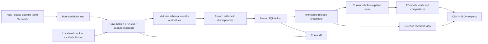

# Housing Supply Observatory

[](https://github.com/LuciferDataEngineer/housing-slump-radar/actions/workflows/ci.yml)

**A release-vintage warehouse for Australian housing approvals.** Load an ABS workbook, preserve its source bytes, compare revisions, and query monthly housing supply indicators without losing the earlier release.

The practical question is: **did the housing indicator change because another month arrived, or because earlier months were revised?** Analysts need both the current figures and a traceable explanation of what changed between releases.

Built on 2 November 2026, when the ABS published its September building approvals release. The existing repository slug is `housing-slump-radar`; this implementation measures approvals and revisions and does not infer a housing slump, house prices, affordability, or a causal effect of interest rates.

## Why this project matters now

The [September ABS release](https://www.abs.gov.au/statistics/industry/building-and-construction/building-approvals-australia/sep-2026) includes revisions to earlier observations. A pipeline that simply overwrites a table hides those revisions; a pipeline that appends without keys creates duplicates. This project stores immutable release snapshots and exposes their differences through SQL.

It ingests **Table 09's original counts**, covering houses, dwellings excluding houses, and total dwellings for eight states/territories and Australia. Original series retain seasonality. The ABS headline uses a different, seasonally adjusted series. Approvals authorise construction; they are not completed or available homes. [Definitions, exact sources and reuse terms](docs/SOURCES.md).

## Observed result

The working example retains **27,999 observations across two releases**, identifies **120 revised historical cells**, and preserves **27 new September observations**. All **22 deterministic tests passed**, including transaction rollback and export recovery. The three CSV outputs were checked row for row against SQL results. [Validation evidence](docs/VALIDATION.md).

| Example | August archive | September archive |
| --- | ---: | ---: |
| Australia's August 2026 total approvals, original | 16,968 | 17,174 |

That **+206 revision** concerns the same month and series. It is different from a change between August and September activity. Each source also contains 36 historical arithmetic discrepancies, which remain visible as quality findings. See the [captured report](examples/report-2026-11-02.json).

## Architecture



## Stack and rationale

| Component | Technology | Reason |
| --- | --- | --- |
| Ingestion and CLI | Python 3.11+ | Explicit validation, standard-library HTTP, logging and small deployment footprint |
| Workbook reader | openpyxl 3.1.5 | Reads the publisher's typed dates, values and series metadata directly |
| Database | SQLite | Transactions, primary/foreign keys, indexed SQL and immutable history in one portable file |
| Transformations | SQL views | Inspectable release ordering, calendar comparisons and revision logic |
| Tests | unittest + generated XLSX fixtures | Repeatable offline tests for failure cases |
| CI | GitHub Actions, Python 3.11 and 3.14 | Tests the installed package on two supported Python versions |

Two complete releases contain fewer than 30,000 observations. A local relational database makes the engineering behaviour easy to inspect. No paid infrastructure is required.

## Quick start

```bash
git clone https://github.com/LuciferDataEngineer/housing-slump-radar.git
cd housing-slump-radar
python3 -m venv .venv
source .venv/bin/activate
python -m pip install .
python -W error::ResourceWarning -m unittest discover -s tests -v
housing-radar --help
```

Fetch the two source releases used in the worked example. These requests are free and need no credentials:

```bash
housing-radar fetch --release-period 2026-08 --published-at 2026-09-30 --data-dir data
housing-radar fetch --release-period 2026-09 --published-at 2026-11-02 --data-dir data
```

`published-at` is the announced release date supplied by the operator. Capture time is recorded separately. The archive files served today do not prove which exact bytes were available on that announced date.

For an offline demonstration, generate a clearly fictional workbook:

```bash
python - <<'PY'
import sys
sys.path.insert(0, 'tests/fixtures')
from generate_workbook import build_workbook
build_workbook('demo-data/synthetic-2026-09.xlsx')
PY
housing-radar ingest --file demo-data/synthetic-2026-09.xlsx --release-period 2026-09 --published-at 2026-11-02 --data-dir demo-data
```

**Every value in that generated workbook is synthetic.** Keep demonstration and live data in separate directories.

## Engineering behaviour

- **Idempotency:** identical bytes for the same release period and edition do not duplicate observations. A replay can regenerate exports.
- **Immutable history:** different bytes for an existing release/edition are rejected. Use an explicit new edition after inspecting a genuine source correction; earlier editions remain queryable.
- **Late arrivals:** current data is selected by release period and edition, so backfilling an older release cannot replace the latest release.
- **Whole-snapshot selection:** current queries use one complete release, without filling gaps from older releases.
- **Strict contracts:** unexpected series, metadata, invalid values, missing months, duplicates and truncated workbooks stop the load.
- **Source quality:** arithmetic discrepancies in otherwise valid official records are recorded as warnings. Published values remain unchanged.
- **Transactional loads:** snapshot metadata, observations and quality findings commit together. A failed write cannot leave half a release in the business tables.
- **Provenance:** source URL, capture time, raw bytes and SHA-256 accompany the release; audits retain ingestion failures. Download failures before ingestion are reported through stderr.
- **Export recovery:** the latest output pointer changes only after the complete export generation succeeds. A committed database can be re-exported after an output failure.

## Reading the results

Select **one geography level and one dwelling category** before aggregating. Adding Australia to its state components, or total dwellings to houses and other dwellings, double-counts the same approvals.

Current monthly metrics use one vintage throughout. A trailing annual total requires twelve consecutive observations. Annual comparisons use the same reference month one year earlier; a missing or zero baseline produces a null percentage. Changes between release vintages compare the same series and reference month. Newly introduced and removed observations are separated from revised historical cells; removed values are not interpreted as zero.

An annual total of original monthly observations reduces seasonal distortion but does not establish causation, forecast completions or replace ABS seasonally adjusted analysis. A count of changed cells is not a count of distinct dwelling approvals.

## Documentation

- [Sources, access dates, definitions and attribution](docs/SOURCES.md)
- [Database model and metric dictionary](docs/DATA_MODEL.md)
- [Recovery and operating procedures](docs/OPERATIONS.md)
- [Observed validation and reproducible examples](docs/VALIDATION.md)
- [SQL examples](sql/analysis.sql)

## Limitations

This is a focused portfolio implementation for one ABS workbook contract. It is not a production service or a real-time feed. It covers approvals by state and broad dwelling type, not suburbs, lending or prices. Two retrieved archive releases demonstrate observed revisions, not the complete release history or an information set available at a past moment. Missing/suppressed values currently fail the strict numeric contract rather than becoming zero. A future publisher schema change requires an explicit parser update.

Source arithmetic warnings remain visible in outputs. Unexplained differences should be investigated before using an affected series in reconciled reporting. Tests run offline; live-source checks are bounded and documented separately. Run one pipeline process per data directory; concurrent exporters can finish out of order. See the [operating contract](docs/OPERATIONS.md).

## Interview talking points

1. Explain why observation month, release reference period, announced publication date and capture timestamp are different concepts.
2. Demonstrate an identical replay, a revised edition and a late backfill. Explain how immutable keys prevent accidental replacement.
3. Contrast a structural contract failure with a valid source record that fails an arithmetic quality rule.
4. Explain the transaction boundary and recovery after a database commit followed by export failure.
5. Show how overlapping geographic/category aggregates create double counting, and how incomplete windows or zero baselines distort growth metrics.
6. Discuss the next scale boundary: additional publishers and vintages may justify partitioned object storage and a server database. Those are future extensions, not implemented components.

## Licence

Project code and synthetic fixtures: [MIT](LICENSE). Source data and transformed examples: ABS material under CC BY 4.0, with attribution and exclusions described in [SOURCES.md](docs/SOURCES.md). The ABS has not endorsed this project.
