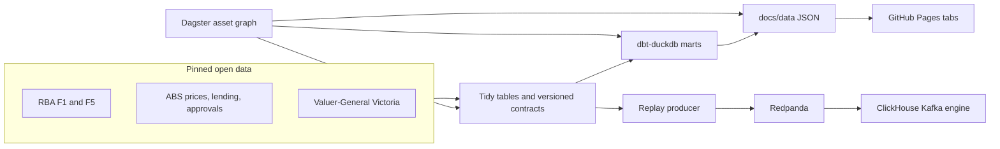

# Housing slump radar

[](https://github.com/LuciferDataEngineer/housing-slump-radar/actions/workflows/ci.yml)

A monitoring dashboard for Australia's 2026 housing downturn. It answers three questions in plain language:

1. Where buyer and lender risk is building, from price falls and higher repayments.
2. Where home approvals are falling, and where an old month was only revised.
3. How much a typical new loan repayment has risen on the path to a 4.85% cash rate.

The live pages are at **https://luciferdataengineer.github.io/housing-slump-radar/**. They are static. ClickHouse and Redpanda run on your machine for the streaming demo. They are not part of the public site.

Figures on the pages are computed from the Reserve Bank, the ABS and the Victorian Valuer-General. Cotality and PropTrack are cited as news and are not plotted. This is not financial, credit or planning advice.

## Why this week

Two releases landed on top of each other.

On **2 November 2026**, Cotality's Home Value Index fell 1.2% in October, a seventh monthly decline. The ABC reported the index about 6.7% ($63,000) under its March peak, with capital-city values down 8.1% in seven months, the fastest such fall in about 40 years. Sales over three months were about 23% lower than a year earlier. PropTrack published a smaller fall. [ABC, 2 November](https://www.abc.net.au/news/2026-11-02/house-prices-fall-in-october-biggest-downturn-40-years-cotality/107325214). [Cotality, 2 November](https://www.cotality.com/au/insights/articles/housing-downturn-broadens-as-brisbane-and-perth-lead-the-decline).

On **3 November 2026** the Reserve Bank raised the cash rate 25 basis points, effective **4 November at 4.85%**. It was the fifth rise of 2026. [RBA media release 2026-30](https://www.rba.gov.au/media-releases/2026/mr-26-30.html). Table F1, published 5 November, records 4.85% on 4 November.

Official series move more slowly than a private monthly index. The dashboard keeps them separate so a reader can see what is already in the ABS and RBA tables, and what is still only a headline.

## What the open data says

Computed from the pinned files. Rounded the way the pages show them.

| Reading | Number | Status on the page |
| --- | ---: | --- |
| Cash rate target, effective 4 Nov 2026 | 4.85% | Act |
| Rises in the target during 2026 | 5, from 3.60% at the end of 2025 | Act |
| Discounted owner-occupier variable rate, Dec 2025 | 6.05% | |
| Same rate, published for Sep 2026. It last moved in May | 6.80% | Act |
| If the 0.50 percentage points since May are passed on in full | 7.30% | Scenario, not a bank quote |
| Average new housing loan, Jun quarter 2026, seasonally adjusted | $727,494 | |
| Monthly repayment at the Dec 2025 rate | $4,385 | |
| Monthly repayment at the published 6.80% | $4,743 | |
| Monthly repayment at the 7.30% scenario | $4,987 | Up $602 from December |
| ABS mean dwelling price, Australia, June quarter 2026 | $1,100,400 | −0.7% in the quarter, +6.8% on the year |
| States where that mean price fell in the June quarter | NSW, Victoria, ACT | Other states were still rising |
| Victoria dwelling approvals, Sep 2026 vs Sep 2025 | 3,918 vs 5,588 | −29.9% |
| Australia dwelling approvals, same comparison | 18,318 vs 18,633 | −1.7% |
| Revision of August's national total in the September release | +206 | 16,968 became 17,174 |
| New loan commitments, Jun quarter, seasonally adjusted | 134,225 | +0.1% on a year earlier |
| Victorian suburbs with enough sales in both March quarters | 468 | Typical suburb still +7.4% |
| Of those, suburbs whose median fell, and fell by more than 5% | 101 and 58 | Steepest in this file: Toorak, −33.2% on 16 sales |

The repayment is a 30-year principal-and-interest loan with no fees and no offset. The loan size is the ABS average new commitment for total dwellings, excluding refinancing. Banks may not pass on the whole 0.50 percentage points. The September lending-rate table does not yet contain the 30 September or 4 November cash-rate steps.

ABS new-loan counts are about flat. That is a different series from Cotality's 23% drop in sales. Both can be true. The page says so.

## Architecture



DuckDB builds the marts. ClickHouse serves a stream of those published observations. The public site never calls either database.

## What is new here

Earlier portfolio work stopped at a rate calculator or a single warehouse. This repo adds the pieces that were not in those projects:

- **ClickHouse** as a local OLAP serving layer, including a Kafka engine table and a materialized view.
- **Redpanda** as the Kafka-compatible broker. A small producer replays real published observations. It does not invent prices.
- **Three data-mesh domains**, each with a versioned contract and CI checks: `prices`, `credit`, `supply`.
- **dbt-duckdb** marts that are the only source of the dashboard numbers.
- **Dagster** asset graph: tidy tables, contracts, dbt, then the JSON.
- A measured **DuckDB vs ClickHouse** note, below, from this machine.

The supply domain keeps one idea from the earlier approvals warehouse on this repo: two ABS Table 09 vintages, so a revision of August is not mistaken for a new month. The product around it is the slump radar, not a release archive.

## Stack

| Piece | Choice | Why |
| --- | --- | --- |
| Transforms | dbt-duckdb | One file, SQL tests, no server to leave running |
| Contracts | YAML plus a small checker | Versioned expectations for the three domains, run in CI |
| Orchestration | Dagster assets | The same functions as the CLI, as a graph you can materialize |
| Serving demo | ClickHouse 24.8 in Docker | Subscribes to the broker and answers SQL |
| Stream | Redpanda 24.3 in Docker | Kafka protocol, no paid cluster |
| Dashboard | Static HTML, CSS and JS | GitHub Pages, no build service |
| Tests | pytest, ruff, dbt tests | Offline. CI does not start ClickHouse |

Nothing in the demo path is a paid API, a hosted database, or a secret. The ClickHouse user `radar` / password `radar` in `docker-compose.yml` is a local demo login because current ClickHouse images disable the default user on the network. It is not used by the website.

## Dashboard

Six tabs, one screen each. The tab bar scrolls sideways on a phone.

Overview, Prices, Credit & repayments, Supply & approvals, Suburbs, Actions.

Each chart has a sentence for a title, the number on the mark, and a Good / Watch / Act badge. The badge rules are project thresholds, not official classifications:

- Price or approvals change: Act at −2 percentage points for a quarterly mean price, −10 for approvals, −5 for a suburb median. A smaller fall is Watch.
- Repayment: Act when the monthly payment is up $300 or more on December 2025.
- A revision of 50 homes or more is Watch. It is a data change, not a collapse.

Open the site from a local server. Opening the HTML file directly will not load the JSON.

```bash
python -m http.server -d docs 8080
```

Then visit http://127.0.0.1:8080/.

## Run the numbers

Python 3.11 or newer. The commands below use a virtual environment.

```bash
python3 -m venv .venv
source .venv/bin/activate
pip install -e ".[dev,stack]"
housing-radar verify
housing-radar build
housing-radar check
pytest -q
```

`build` writes the tidy tables, checks the contracts, runs `dbt build`, and refreshes `docs/data/*.json`. `check` fails if that JSON drifts from the marts.

Dagster, from the repo root with the same environment:

```bash
dagster dev -m housing_radar.orchestration.definitions
```

The graph is `tidy_tables` → `contract_results` → `dbt_marts` → `dashboard_json`. CI materializes the first two assets and runs the full build through the CLI.

To refresh a publisher file later:

```bash
housing-radar fetch          # keeps the pinned bytes unless the hash matches
housing-radar fetch --update # accepts a new hash and prints it
```

Direct downloads from land.vic.gov.au returned HTTP 403 on 5 November 2026. The fetch script falls back to the Wayback capture of the same official URL. Details, checksums and licences are in [documentation/SOURCES.md](documentation/SOURCES.md).

## Streaming demo

Docker is only needed for this section. The compose file uses host networking so ClickHouse and the producer both use `127.0.0.1:9092`.

```bash
docker compose up -d
python -m housing_radar.stream_demo
```

The script waits for ClickHouse, creates a MergeTree, a Kafka engine table and a materialized view, and publishes ten events: the latest cash-rate target and the latest mean price for Australia and each state. It then prints a grouped query. The events are labelled as replays of RBA and ABS figures. Running it again appends another batch. Delivery is at least once, so a retry can duplicate a row. That is the broker, not a second official print.

Tear down with `docker compose down`.

## DuckDB vs ClickHouse

Same shape of query on **2,000,000 synthetic rows** (eight state ids, a generated price, a generated year-on-year change). Not official prices. Machine: 4 vCPU Intel Xeon, Linux, Python 3.12, DuckDB 2.0, ClickHouse 24.8. Cost: **$0**. No warehouse bill, no reserved server.

| Engine | What was timed | Median |
| --- | --- | ---: |
| DuckDB, in process | 5 runs after 2 warmup runs | 15.9 ms |
| ClickHouse server | median of the last 5 `system.query_log` durations | 13 ms |
| ClickHouse over HTTP from Python | 5 runs after 2 warmup runs | 15.0 ms |

The query groups by state and computes a count, a median price and an average change. Full samples are in [documentation/bench-results.json](documentation/bench-results.json). Re-run with ClickHouse already up:

```bash
python -m housing_radar.microbench
```

At two million rows the engines are a few milliseconds apart, and the samples overlap. That is not a reason to pick ClickHouse for this transform. DuckDB is the right build tool: it is embedded, the marts are a file, and CI does not need a database service. ClickHouse earns its place as the serving layer that can sit on a Redpanda topic and keep a MergeTree current. The operational cost of that choice is a container and a local login, not a licence.

## Contracts

| Domain | Contract | What it guards |
| --- | --- | --- |
| credit | `contracts/credit/cash_rate.v1.yaml` | Daily F1 target. The latest value must be 4.85 |
| credit | `contracts/credit/lending_rates.v1.yaml` | F5 housing rates. Latest discounted owner-occupier rate must be 6.80 |
| credit | `contracts/credit/loan_commitments.v1.yaml` | ABS new commitments, total dwellings excluding refinancing |
| prices | `contracts/prices/mean_dwelling_price.v1.yaml` | ABS mean price. Australia, June quarter 2026, must be $1,100,400 |
| prices | `contracts/prices/suburb_median.v1.yaml` | Quarterly Valuer-General medians, including the Toorak March 2026 print |
| prices | `contracts/prices/suburb_annual.v1.yaml` | Annual medians, 2015–2025 |
| supply | `contracts/supply/building_approvals.v1.yaml` | Both Table 09 vintages. September 2026 Australia total must be 18,318 |
| supply | `contracts/supply/approval_quality.v1.yaml` | Arithmetic gaps inside Table 09, kept rather than rewritten |

A breaking change to a tidy table needs a new contract version. CI runs the checks with no network.

## Pages deployment

The repository is already set to GitHub Pages `build_type: workflow`. `.github/workflows/pages.yml` publishes the `docs/` folder on a push to `main`. The address is https://luciferdataengineer.github.io/housing-slump-radar/. A pull request does not update the live site until it is merged.

## Limits

- The June-quarter mean price and the March-quarter Victorian medians do not yet show the October private-index fall. The pages say that.
- Approvals are original counts. Compare a month with the same month a year earlier. The ACT series is a small base and the percentage swings.
- Do not add Australia to the states, or total dwellings to houses plus other dwellings.
- Suburb ranks drop any quarter flagged as fewer than 10 sales. Toorak's fall is on 16 sales. Read the count.
- One process should own a data directory. The DuckDB file lives in `dbt/target/` and is not committed.

## Licence

Code is [MIT](LICENSE). ABS and Victorian Government tables are CC BY 4.0. RBA tables are used with acknowledgement. None of those publishers endorse this project.
